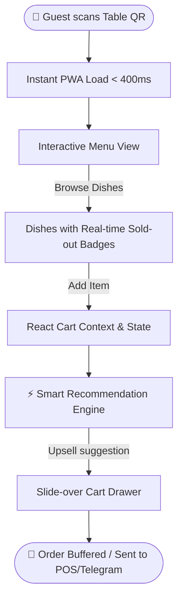

# 🍽️ La Veranda SmartFlow

> High-performance digital menu & ordering PWA engineered for HoReCa to eliminate peak-hour service bottlenecks and drive cross-sell conversion.


---

## 💡 The Problem & Product Value (Product-First)

During high-traffic dining rushes (lunch & dinner peaks), waiting staff becomes the critical operational bottleneck. Guests spend an average of 7–12 minutes waiting for a printed menu and waiter availability just to place their initial order.

**La Veranda SmartFlow** is an ultra-fast, zero-friction Progressive Web Application designed to be delivered instantly via QR Code or WiFi Captive Portal:
* **Zero App Installation:** Instant load in under 400ms on mobile browsers without App Store friction.
* **Higher Table Turnover:** Guests browse dishes, view high-res imagery, and assemble orders immediately upon seating.
* **Smart Upsell & Cross-sell:** Contextual recommendation engine suggesting pairings (e.g., wine, side dishes, desserts) right inside the cart flow, increasing the average order check.

---

## 🛠️ Tech Stack & Key Architectural Decisions

| Layer | Technology | Rationale |
| :--- | :--- | :--- |
| **Framework** | **Next.js 16 (App Router)** | Instant server-side rendering for catalog SEO and lightning-fast client hydration with Turbopack. |
| **Runtime / UI** | **React 19 & Tailwind CSS 4** | Component-driven UI leveraging the latest React 19 primitives and modern JIT styling without runtime overhead. |
| **Language** | **TypeScript 5 (Strict Mode)** | Full end-to-end type safety covering menu schema, cart state mutations, and recommendation payloads. |
| **State Management** | **React Context + Optimistic UI** | Decoupled `CartContext` providing $O(1)$ item updates, instant badge counts, and zero flickering. |
| **Icons & Components** | **Lucide React & Base UI / Radix** | Accessible, headless UI primitives tailored for touch interactions and fluid drawer animations. |

---

## 📐 Architecture & Flow



### Key Technical Highlights:
1. **Ergonomic One-Thumb Mobile UX:** The cart drawer (`CartDrawer.tsx`) and floating badge trigger are anchored to the lower viewport for seamless one-handed operation on modern smartphones.
2. **Availability Safeguards (`isSoldOut`):** Visual indicators and button state disabling prevent placing orders for out-of-stock items, synchronizing restaurant operational reality with guest expectations.
3. **Optimistic Cart Mutations:** Fast cart additions and subtractions without blocking UI thread animations.

---

## 🚀 Getting Started Locally

### Prerequisites
* **Node.js:** `>= 20.x` (Recommended: v24 LTS)
* **Package Manager:** `npm`, `pnpm`, or `yarn`

### Installation & Run

```bash
# 1. Clone the repository
git clone https://github.com/YaadL/la-veranda-smartflow.git
cd la-veranda-smartflow

# 2. Install dependencies
npm install

# 3. Start development server
npm run dev

# 4. Open in browser
# Navigate to http://localhost:3000
```

### Production Build

```bash
# Build optimized static and server bundle with Turbopack
npm run build

# Start production server
npm start
```

---

## 👨‍💻 Author

**Daniil Mikhailov**  
* Specialization: Frontend / Mobile Developer & Product Engineer  
* Philosophy: **Zero Black Box** — deep understanding of runtime performance, memory efficiency, and user-centric architecture.  
* GitHub: [@YaadL](https://github.com/YaadL)
